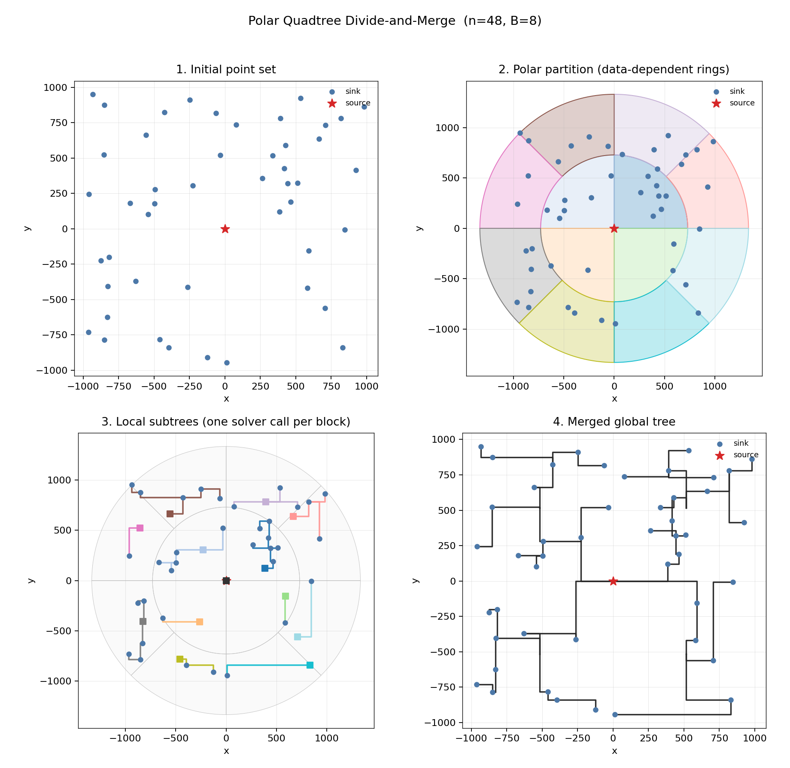
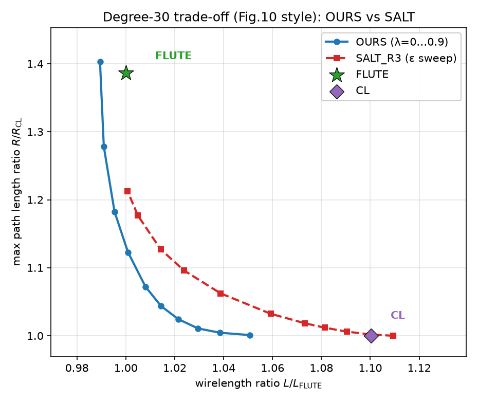

# Towards Timing-Driven Routing: An Efficient Learning Based Geometric Approach

ICCAD 2023 implementation: GNN/RL Actor for moderate-degree nets, plus the **data-dependent polar quadtree divide-and-merge** heuristic for large-degree nets.

Paper: [ICCAD 2023](https://mrsun0.github.io/gwsun.github.io/files/Routing_Wirelength_Timing.pdf)



The figure is a real run with `n=48` pins and block capacity `B=8` (source is the red star at the origin):

1. **Initial point set** — input pins; `points[0]` is the source.
2. **Polar partition** — data-dependent rings (4 / 8 / 16 … sectors); each nonempty block holds at most `B` pins.
3. **Local subtrees** — each block calls the local solver (`points[0]` of that subset is the local source). For moderate blocks this is the Timing-RST Actor; a rectilinear MST is the fallback.
4. **Merged global tree** — bidirectional binary-tree search stitches subtrees into one rectilinear tree.

## Clarification on Metric Definitions

We noticed that a recent work ([PatLabor](https://chen-zhi-yang.github.io/files/Pareto_Optimization_of_Timing_Driven_Routing_Trees.pdf), DAC'25) reimplements our method (referred to as YSD) and reports trade-off curves that appear worse than SALT in some ranges. We clarify the metric definitions as follows.

- **In our paper (Timing-RST)**, the radius \(R\) is the **maximum source–sink path length** on the routing tree:
  \[
  R(T)=\max_{v\in V\setminus\{s\}} d_T(s,v).
  \]
  Fig. 10 uses the normalized axes \(L/L_{\mathrm{FLUTE}}\) and \(R/R_{\mathrm{CL}}\).

- **In SALT**, the path metric is the **shallowness** \(\alpha\), i.e. the **maximum stretch relative to the Manhattan distance**:
  \[
  \alpha(T)=\max_{v\in V\setminus\{s\}} \frac{d_T(s,v)}{d_G(s,v)}.
  \]
  SALT's lightness \(\beta'=w(T)/w(\mathrm{FLUTE})\) is analogous to our normalized wirelength, but \(\alpha\) is **not** the same as our \(R/R_{\mathrm{CL}}\).

Even when evaluation protocols differ, the released results still demonstrate the effectiveness of our architecture and training. If one prefers SALT's \(\alpha\)-style objective, the loss can be rewritten accordingly and training restarted with little extra engineering.

## Degree-30 trade-off (same 10k nets)

Test set: `data/test_data/array_degree30_num10000.npy`. `inference.py` reports both wirelength \(L\) and radius \(R\) (max source–sink path).

Normalized axes match Fig. 10: \(X=L/L_{\mathrm{FLUTE}}\), \(Y=R/R_{\mathrm{CL}}\).

Baseline points on this set:

| Method | \(X=L/L_{\mathrm{FLUTE}}\) | \(Y=R/R_{\mathrm{CL}}\) |
| --- | --- | --- |
| FLUTE | 1.000 | 1.387 |
| CL (RSA approx.) | 1.100 | 1.000 |

### OURS (\(\lambda\)-sweep)

| \(\lambda\) | \(L\) | \(R\) | \(X\) | \(Y\) |
| --- | --- | --- | --- | --- |
| 0.0 | 4.1621 | 1.8038 | 0.9894 | 1.4029 |
| 0.1 | 4.1687 | 1.6431 | 0.9910 | 1.2779 |
| 0.2 | 4.1871 | 1.5203 | 0.9954 | 1.1824 |
| 0.3 | 4.2103 | 1.4435 | 1.0009 | 1.1227 |
| 0.4 | 4.2404 | 1.3784 | 1.0081 | 1.0721 |
| 0.5 | 4.2672 | 1.3419 | 1.0144 | 1.0436 |
| 0.6 | 4.2970 | 1.3170 | 1.0215 | 1.0243 |
| 0.7 | 4.3306 | 1.2996 | 1.0295 | 1.0108 |
| 0.8 | 4.3688 | 1.2914 | 1.0386 | 1.0044 |
| 0.9 | 4.4199 | 1.2870 | 1.0507 | 1.0010 |

### SALT (\(\varepsilon\)-sweep)

| \(\varepsilon\) | \(L\) | \(R\) | \(X\) | \(Y\) |
| --- | --- | --- | --- | --- |
| 0 | 4.6663 | 1.2858 | 1.1093 | 1.0000 |
| 0.05 | 4.6290 | 1.2881 | 1.1004 | 1.0018 |
| 0.1 | 4.5870 | 1.2935 | 1.0904 | 1.0060 |
| 0.15 | 4.5487 | 1.3010 | 1.0813 | 1.0118 |
| 0.2 | 4.5145 | 1.3094 | 1.0732 | 1.0184 |
| 0.3 | 4.4559 | 1.3273 | 1.0593 | 1.0323 |
| 0.5 | 4.3694 | 1.3660 | 1.0387 | 1.0624 |
| 0.75 | 4.3066 | 1.4092 | 1.0238 | 1.0960 |
| 1 | 4.2666 | 1.4490 | 1.0143 | 1.1269 |
| 1.5 | 4.2274 | 1.5128 | 1.0050 | 1.1766 |
| 2 | 4.2094 | 1.5594 | 1.0007 | 1.2128 |

### Comparison figure



CSV sources: `results/ours_degree30.csv`, `results/salt_degree30.csv`, `results/fig10_degree30_flute_cl_points.csv`, `results/fig10_degree30_tradeoff.csv`.

## Runtime Measurement

The runtimes reported in the paper are measured with the neural network **batch mechanism**, following the evaluation methodology of REST [1]: instead of solving nets one by one, multiple nets are packed into a batch and inferred simultaneously on the GPU. Heuristic methods accelerate computation through multi-threading, but their parallelism is bottlenecked by the number of CPU cores and therefore rather limited. In contrast, a neural network batch can scale to thousands or even tens of thousands of nets, offering a far larger degree of parallelism and thus a significant speedup.

[1] J. Liu, G. Chen and E. F. Y. Young, "REST: Constructing Rectilinear Steiner Minimum Tree via Reinforcement Learning," 2021 58th ACM/IEEE Design Automation Conference (DAC), San Francisco, CA, USA, 2021, pp. 1135-1140, doi: 10.1109/DAC18074.2021.9586209.

## Layout

| Path | Role |
| --- | --- |
| `models/`, `train_lambda.py`, `train_scratch.py` | Section II Actor-Critic (PyTorch) |
| `inference.py` | Test: `degree<=32` uses Actor batch inference; `degree>32` uses divide-and-merge |
| `utils/divide_merge.py` | Python divide-and-merge (same solver protocol as C++) |
| `utils/nn_solver.py` | Wraps the Actor as `solver(points) -> tree` |
| `algorithms/polar_quadtree/` | C++17 reference implementation of Section III |
| `algorithms/eval.c` | Original GeoSteiner length evaluator |

## Requirements

- PyTorch >= 1.9.0
- C++17 + CMake (only if you build the polar quadtree binaries)

## Train

The model was trained using two GPUs by default, utilizing the DDP module. To initiate the training process, you can use the command `torchrun`.

```shell
sudo env PATH="$PATH" CUDA_VISIBLE_DEVICES=0,1 torchrun --master_port=10002 --nproc_per_node=2 train_lambda.py --degree 10 --batch_size 2048 --weight 0.5
```

- `CUDA_VISIBLE_DEVICES`: GPUs to use
- `master_port`: torchrun port
- `nproc_per_node`: number of GPUs
- `degree`: net degree of the training samples
- `weight`: trade-off `λ` between wirelength and max source–sink path (`R`)

## Test (moderate-degree nets)

Download the well-trained checkpoints from Google Drive into `save/beCalled/`. The default `transform` in `inference.py` is 8; set it to 1 for a faster run.

```shell
python inference.py
python inference.py --degree 30 --weight 0.0 --transform 8
```

If `data/test_data/array_degree*_num*.npy` is missing, random nets are generated.

## Test (large-degree nets, divide-and-merge)

When `--degree` is greater than 32, `inference.py` partitions the net with the polar quadtree and calls the Actor on each block (`B=30` by default, matching the paper). Every solver call uses **index 0 as the source**.

```shell
python inference.py --degree 100 --eval_size 20 --capacity 30 --device cuda:0
```

Without a checkpoint, you can still exercise the skeleton with a rectilinear MST local solver:

```shell
python inference.py --degree 80 --eval_size 5 --capacity 8 --fallback_mst --device cpu
```

## Build the C++ divide-and-merge library

```shell
cmake -S . -B build
cmake --build build
./build/algorithms/polar_quadtree/test_divide_merge
./build/algorithms/polar_quadtree/pqt_demo
```

C++ API (`points[0]` is the global source):

```cpp
#include "polar_quadtree/framework.h"
#include "polar_quadtree/solvers.h"

pqt::Tree my_model(const std::vector<pqt::Point>& pts);  // pts[0] = source
auto tree = pqt::divide_and_merge(pins, my_model, /*capacity=*/30);
```

Python API (same protocol):

```python
from utils.divide_merge import divide_and_merge
from utils.nn_solver import TimingRSTSolver

solver = TimingRSTSolver("save/beCalled/0.0/trst30_0.0b.pt", degree=30)
tree = divide_and_merge(points, solver, capacity=30)
# tree["nodes"], tree["edges"]
```

To regenerate the four-panel figure:

```shell
./build/algorithms/polar_quadtree/dump_viz viz/pipeline.json
python scripts/plot_stages.py
```
